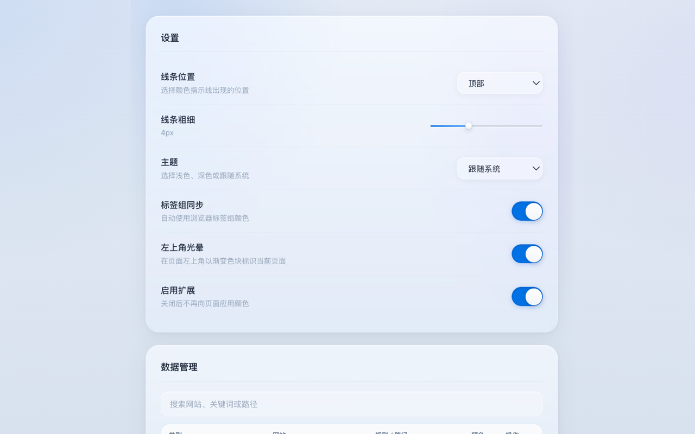

# Page Accent

[](./LICENSE)
[](./src/manifest.config.js)
[](https://github.com/baozheliu/page-accent/actions/workflows/ci.yml)

一个用于 Chrome / Edge 的 Manifest V3 扩展。按本地匹配规则给网站添加彩色标识线，一眼区分不同页面。



## 功能

- 一键标记当前网站；整站规则精确到当前 hostname，并覆盖其全部路径、参数和锚点。
- 关键词规则在指定 hostname 内匹配路径、参数、锚点和页面标题，不会误匹配同一主域下的其他子域名。
- 支持多种纯色和红黄绿组合色，并可同步浏览器标签组颜色。
- 页面刷新后会根据已保存路径和规则自动恢复网页顶部彩色标识线。
- 支持快捷键：
  - `Alt+1`：标记为红色。
  - `Alt+2`：标记为蓝色。
  - `Alt+3`：标记为绿色。
  - `Alt+0`：移除当前页颜色。
- 配置页提供面向非技术用户的规则积木：
  - 域名前缀，例如 `docs.example.com` 的 `docs`。
  - 路径片段，例如 `/project/123` 中的 `project`。
  - URL 参数，例如 `?view=board`。
- 侧边栏用于快速查看当前命中状态、已保存路径标记和规则。

## 开发

需要 Node.js 18+ 与 npm 9+。

```bash
npm install
npm run dev
npm run build:chrome
npm run build:edge
npm run build:firefox
npm run check
```

构建产物在 `dist/`。在浏览器扩展管理页打开开发者模式，然后加载 `dist/` 目录即可。

## 权限与隐私

| 权限 | 用途 |
| --- | --- |
| `activeTab` | 响应用户在当前标签页上的标记操作 |
| `storage` | 在浏览器本地保存设置、颜色标记和匹配规则 |
| `tabs` | 跟踪标签页变化并从侧边栏定位已标记页面 |
| `contextMenus` | 提供右键标记、移除和创建规则操作 |
| `sidePanel` / `tabGroups` | Chromium 侧边栏与可选标签组颜色同步 |
| HTTP/HTTPS 主机权限 | 在用户访问的网页上显示颜色线、角标并匹配本地规则 |

Page Accent 不提供账号系统、远程同步、遥测或开发者后端。页面 URL、标题、颜色标记和规则保存在浏览器本地；所有可执行代码均包含在扩展包内。详见[中文隐私政策](./docs/privacy-policy.md)与[英文隐私政策](./docs/privacy-policy.en.md)。

## 项目结构

```text
src/
├── background/                 # MV3 service worker 入口
├── content/                    # content script 入口
├── extension/
│   ├── background/tab-marks.js # 后台标记控制器
│   ├── content/tab-mark.js     # favicon 兜底标记注入
│   └── browser/                # 浏览器 API Promise 封装
├── pages/
│   ├── popup/                  # 当前页快速标记
│   ├── options/                # 规则积木配置
│   └── side-panel/             # 找回面板
└── shared/
    ├── settings.js
    └── tab-marks.js            # URL 规范化、颜色、规则匹配
```

更详细的模块和数据流说明见[架构文档](./docs/architecture.md)。

## 贡献与安全

欢迎贡献。提交 Issue 或 Pull Request 前请阅读 [CONTRIBUTING.md](./CONTRIBUTING.md) 与 [CODE_OF_CONDUCT.md](./CODE_OF_CONDUCT.md)。

安全问题请按 [SECURITY.md](./SECURITY.md) 私下报告，不要在公开 Issue 中披露可利用细节。

## License

[MIT](./LICENSE) © baozheliu
